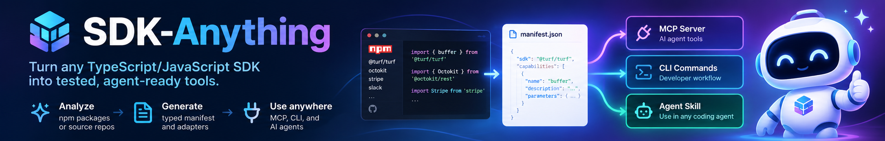

<p align="center">
  
</p>

<p align="center">
  <strong>Today's SDKs Serve Human Developers 👨‍💻. Tomorrow's Callers will be AI Agents 🤖.<br>
  SDK-Anything: Bridging the Gap Between AI Agents and the World's Software Libraries</strong>
</p>

<p align="center">
  <a href="#-quick-start"></a>
  <a href="#-test-results"></a>
  <a href="#-why-sdk-anything"></a>
  <a href="LICENSE"></a>
  <a href="README.zh-CN.md"></a>
</p>

<p align="center">
  
  
  
  
  
</p>

**One Command Pipeline**: Turn any TypeScript or JavaScript SDK into agent-ready tools for Claude Desktop, Cursor, Claude Code, OpenClaw, Codex, Windsurf, and custom autonomous agents.

---

## 🌟 Why SDK-Anything?

Traditional SDKs are crafted for human programmers navigating IDE auto-complete. When fed raw into an LLM, they overwhelm reasoning budgets, leak tokens, and trigger accidental side effects.

| The Raw SDK Dilemma | The SDK-Anything Agent-Native Solution |
|---|---|
| **Context Window Overload**<br>Hundreds of exported helper functions flood token limits. | **Deterministic Atomic Tools**<br>Curated, typed operations with concise descriptions and strict parameter schemas. |
| **Accidental Side Effects**<br>Agent blindly invokes destructive delete or billing endpoints. | **Conservative Effect Guard**<br>`pure` and `read` are enabled by default; `write`, `destructive`, and `unknown` are strictly disabled by default. |
| **Credential & Secret Leaks**<br>Tokens passed in prompt strings or printed in stack traces. | **Reference-Only Secret Model**<br>Stores only `env:VAR_NAME` references; runtime engine redacts all tokens from error messages. |
| **Memory Exhaustion**<br>Unbounded pagination iterators crash agent processes. | **Strict Bounded Caps**<br>Enforces per-call item limits (default 100) and payload byte ceilings (1 MB). |
| **Fragile Black-Box Proxies**<br>Magic dynamic wrappers or unsafe `eval` executors. | **Inspectable TypeScript**<br>Generates clean, auditable, standard TypeScript code ready to review and commit. |

---

## 🤖 Agent Ecosystem Compatibility

From a single capability manifest (`sdk-anything/manifest/v1`), SDK-Anything simultaneously emits triple-interface support:

```text
                           ┌──────────────────────────┐
                           │       SDK-Anything       │
                           │ Capability Manifest (v1) │
                           └────────────┬─────────────┘
                                        │
         ┌──────────────────────────────┼──────────────────────────────┐
         ▼                              ▼                              ▼
  🔌 MCP Server                  ⌨️ Developer CLI               🤖 Consumer Skill
┌────────────────────────┐     ┌────────────────────────┐     ┌────────────────────────┐
│ Claude Desktop         │     │ Terminal Automation    │     │ Claude Code            │
│ Cursor                 │     │ Shell Pipelines        │     │ Codex                  │
│ Windsurf               │     │ CI / CD Scripts        │     │ OpenClaw / Nanobot     │
└────────────────────────┘     └────────────────────────┘     └────────────────────────┘
```

| Agent Platform | Integration Protocol | How to Connect |
|---|---|---|
| **Claude Desktop** | Official MCP Stdio Protocol | Add to `claude_desktop_config.json` |
| **Cursor / Windsurf** | Command-based MCP Transport | Add to `.cursor/mcp.json` |
| **Claude Code** | Native Generator & Consumer Skill | Load via `skills/sdk-anything/SKILL.md` |
| **OpenClaw / Codex / Pi** | Standard Agent Skill Format | Copy generated `SKILL.md` directly |

---

## 🚀 Quick Start

### 1. Installation

```bash
# Clone the repository
git clone https://github.com/janghotan/SDK-Anything.git
cd SDK-Anything

# Install dependencies and build
pnpm install
pnpm run build

# Link CLI globally (optional)
pnpm link --global
```

### 2. Inspect Any SDK in Seconds

Analyze public npm packages, local source folders, or public GitHub repositories **without executing any target package code or lifecycle scripts**:

```bash
# Inspect an npm package
sdk-anything inspect npm:@turf/turf

# Inspect a local TypeScript/JavaScript SDK repository
sdk-anything inspect ./path/to/my-sdk

# Output structured JSON evidence inventory
sdk-anything inspect npm:@turf/turf --json
```

Output preview:
```text
Resolved source: npm:@turf/turf
Kind:            npm
Version:         7.2.0
Digest:          sha256:196883847d5efc475a4c897753397199e1fabe332f631cf0202587a31bd17ffb
Entry point:     index.ts
Functions:       78 (distance, area, point, buffer, ...)
Classes:         0 (none)
Factories:       0 (none)
Unresolved:      0
```

### 3. Generate Overrides (Optional)

For SDKs requiring client constructors, factories, or secret authentication tokens:

```bash
sdk-anything inspect ./path/to/my-sdk --write-overrides
```

This creates an editable `sdk-anything.overrides.json`:
```json
{
  "schemaVersion": "sdk-anything/overrides/v1",
  "client": {
    "construction": "class",
    "export": "ApiClient",
    "options": {
      "apiKey": {
        "type": "secret",
        "source": "env:MY_SERVICE_API_KEY",
        "required": true
      }
    }
  },
  "operations": {
    "records.delete": {
      "effect": "destructive",
      "enabledByDefault": false
    }
  }
}
```

### 4. Generate MCP Server, CLI, and Skill

```bash
# Generate complete agent project into output directory
sdk-anything generate npm:@turf/turf \
  --targets mcp,cli \
  --output ./generated/turf-tools

# Optional: Enable OpenAI-compatible AI assistance for enriched descriptions
sdk-anything generate npm:@turf/turf \
  --targets mcp,cli \
  --ai \
  --output ./generated/turf-tools

# Standalone output for an unpublished or locally built SDK: copy the built
# package into the generated project and install it with a relative file: spec
sdk-anything generate ./path/to/my-sdk \
  --vendor-sdk ./path/to/my-sdk-dist \
  --output ./generated/my-sdk-tools

# Or pin the dependency specifier explicitly
sdk-anything generate ./path/to/my-sdk \
  --sdk-dependency "file:../my-sdk-dist" \
  --output ./generated/my-sdk-tools
```

All discovered operations are exposed by both adapters. Pure/read operations run by default;
write, destructive, and unknown operations are discoverable but **fail closed** until explicitly
authorized (`--allow-effects`, `--allow-operations`, or `--allow-destructive` on the CLI;
`SDK_ANYTHING_ALLOWED_EFFECTS`, `SDK_ANYTHING_ALLOWED_OPERATIONS`, and
`SDK_ANYTHING_ALLOW_DESTRUCTIVE` on MCP).

### 5. Statically Validate, Test & Run Doctor

```bash
# Validate manifest schema and adapter parity (no containers required)
sdk-anything validate ./generated/turf-tools

# Verify bundle integrity, checksums, and environment readiness
sdk-anything doctor ./generated/turf-tools

# Test user-owned trusted code in a sanitized local process
sdk-anything test ./generated/turf-tools --trusted-local

# Test untrusted packages in a container sandbox (fails closed if Docker/Podman missing)
sdk-anything test ./generated/turf-tools --sandbox
```

### 6. Safe Regeneration & Drift Detection

```bash
# Check if generated project has drifted from source without writing files
sdk-anything generate npm:@turf/turf --output ./generated/turf-tools --check

# Regenerate safely; hand-edited files are protected from accidental overwrite
sdk-anything generate npm:@turf/turf --output ./generated/turf-tools

# Explicitly overwrite user edits if desired
sdk-anything generate npm:@turf/turf --output ./generated/turf-tools --force
```

---

## 🎮 Interactive Demos

### Demo A: Calling Generated CLI with Structured JSON or Stdin

```bash
# Calculate distance between two coordinate pairs
$ sdk-cli-turf distance \
    --input '{"from":[-75.343, 39.984],"to":[-75.534, 39.123],"options":{"units":"miles"}}' \
    --json
60.37

# Pipe input JSON directly via stdin
$ echo '{"from":[-75.343, 39.984],"to":[-75.534, 39.123],"options":{"units":"miles"}}' | sdk-cli-turf distance --json
60.37

# Canonical escape hatch: invoke any operation by its unique canonical ID
$ sdk-cli-turf invoke distance --input '{"from":[-75.343, 39.984],"to":[-75.534, 39.123]}' --json
60.37

# Attempting an unauthorized write or destructive call fails before SDK execution
$ sdk-cli-client deleteRecord --input '{"id":"item-123"}' --json
{
  "error": {
    "code": "POLICY_DENIED",
    "message": "Policy denied: operation 'deleteRecord' has effect 'destructive', which is disabled by default.",
    "suggestedAction": "Operation effect is restricted by default. Enable the effect class in invocation options or manifest overrides"
  }
}
```

### Demo B: Consuming Generated MCP Server in Claude Desktop / Cursor

Every generated MCP bundle includes an auto-configured `claude_desktop_config.json`:
```json
{
  "mcpServers": {
    "turf-tools": {
      "command": "node",
      "args": ["./dist/server.js"]
    }
  }
}
```

When Claude calls the tool:
```json
// Tool Call
{
  "name": "distance",
  "arguments": {
    "from": [-75.343, 39.984],
    "to": [-75.534, 39.123],
    "options": { "units": "miles" }
  }
}

// Tool Response
{
  "content": [
    {
      "type": "text",
      "text": "60.37"
    }
  ]
}
```

---

## 📊 Test Results

Every subsystem undergoes rigorous multi-layer testing across 21 groups (23 Vitest files):

| Test Layer | What It Verifies | Tests | Status |
|---|---|:---:|:---:|
| **CLI Bootstrap** | Help text, versioning, exit codes, config resolution | 8 | ✅ Passed |
| **Source Resolver** | npm download, local dirs, GitHub archives, path traversal (`../`), symlinks | 13 | ✅ Passed |
| **Dependency Resolution** | Re-exports, default exports, aggregate packages, override promotions | 4 | ✅ Passed |
| **Dependency Retrieval** | Bounded, script-free npm dependency graph materialisation and semver resolution | 6 | ✅ Passed |
| **TypeScript Analyzer** | TS Compiler API AST, type lowering, enums, index signatures, utility types | 6 | ✅ Passed |
| **Capability Manifest** | v1 schema validation, Ajv checks, canonical byte-stable serialization, overrides, factory clients | 9 | ✅ Passed |
| **Manifest Regeneration** | Checksum inventory, `--check` drift detection, user-edit conflict protection | 5 | ✅ Passed |
| **Shared Runtime** | Invocation harness, policy enforcement, secret token redaction, timeouts | 8 | ✅ Passed |
| **MCP Generator** | Official `@modelcontextprotocol/sdk`, instructions, collision disambiguation, env policy | 5 | ✅ Passed |
| **CLI Generator** | Commander.js commands, adapter parity, stdin piping, policy flags, `invoke` escape hatch | 8 | ✅ Passed |
| **Consumer Skill** | Generated `SKILL.md` format, doc/command consistency, disabled-operation guidance | 3 | ✅ Passed |
| **Vendor SDK Packaging** | Project-root `vendor/`, relative dependency specs, Node 20-safe manifest loading | 2 | ✅ Passed |
| **AI Proposal Layer** | Mock OpenAI endpoint, prompt-injection defense, privacy disclosure, fallback | 6 | ✅ Passed |
| **Security & Sandbox** | Stateful client lifecycle, loopback server, fail-closed container detection | 5 | ✅ Passed |
| **Adversarial Security** | Tarball traversal, symlinks, bombs, URL secret redaction, pagination loop guards | 9 | ✅ Passed |
| **Compatibility Lab** | 6 multi-shape fixtures (pure, authenticated, barrel, types, factory, malformed) | 2 | ✅ Passed |
| **Core Journey & E2E** | inspect → manifest → atomic generation → CLI/MCP verification, including Turf golden runs | 5 | ✅ Passed |
| **Independence & Golden** | Zero repo back-references, independent compilation of generated runtime | 2 | ✅ Passed |
| **Package Distribution** | Tarball whitelist, installed-binary execution, `doctor`, relocatable bundles | 4 | ✅ Passed |
| **Performance & Determinism** | Coarse budgets, byte-identical serialization, AbortSignal cancellation | 4 | ✅ Passed |
| **External Generated Project** | Installed tarball → vendored SDK → `npm install`/build → real CLI process + stdio MCP client | 6 | ✅ Passed |
| **Total** | **100% Pass Rate across 23 test files (0 typecheck/lint errors)** | **121** | **✅ All Green** |

---

## 🏗️ Architecture & Pipeline

```text
Source Locator (npm:pkg, local dir, public GitHub)
       │
       ▼
Deterministic Static Analyzer (TS Compiler AST & TypeChecker, noEmit)
       │
       ▼
Evidence Inventory (Function signatures, parameters, types, unresolved diagnostics)
       │
       ├─────────────────────────────────────────┐
       │ (Optional)                              │ (Deterministic)
       ▼                                         ▼
AI Proposal Layer (OpenAI-compatible)     Capability Manifest Builder (v1)
(descriptions, groups, examples)                 │
       │                                         │
       └────────────────────┬────────────────────┘
                            ▼
                   Human Overrides Engine
                (sdk-anything.overrides.json)
                            │
                            ▼
               Validated Capability Manifest
             (schema: sdk-anything/manifest/v1)
                            │
              ┌─────────────┴─────────────┐
              ▼                           ▼
        MCP Generator               CLI Generator
       (Stdio Server)            (Commander.js CLI)
              │                           │
              └─────────────┬─────────────┘
                            ▼
                   Shared Runtime Layer
     (Input validation, policy enforcer, secrets, pagination caps)
```

---

## 🔒 Security & Sandboxing Principles

1. **Zero Target Code Execution During Inspection:** Target SDKs are never imported or executed during inspection. Installation lifecycle scripts are permanently skipped.
2. **Reference-Only Secrets:** No credentials exist in static files or manifests. Tokens are fetched solely at runtime from `process.env`.
3. **Automated Secret Redaction:** All error messages and logs strip tokens matching `Bearer ...` or known environment secrets.
4. **Conservative Effect Defaults:** `pure` and `read` are active by default. `write`, `destructive`, and `unknown` operations are blocked at runtime unless explicitly enabled.
5. **Fail-Closed Container Sandbox:** Testing untrusted code via `--sandbox` requires Docker or Podman. If unavailable, it halts immediately with an actionable error and **never silently falls back** to host execution.

---

## 📂 Repository Layout

```text
sdk-anything/
├── .github/workflows/ci.yml             # GitHub Actions CI workflow
├── assets/                              # Banners and brand assets
│   ├── sdk-anything-banner-en.png
│   └── sdk-anything-banner-zh.png
├── docs/                                # Comprehensive documentation
│   ├── architecture.md                  # Deep pipeline & subsystem specification
│   └── security.md                      # Security model, trust boundaries, sandboxing
├── examples/                            # Tested reference implementations
│   ├── turf/                            # Pure-function golden example
│   └── client-sdk/                      # Stateful network client fixture
├── schema/
│   └── capability-manifest.schema.json  # Canonical Manifest v1 JSON Schema
├── skills/
│   └── sdk-anything/SKILL.md            # Orchestration skill for host coding agents
├── src/
│   ├── cli/                             # CLI commands, entry point, config
│   ├── source/                          # Safe npm, local, and GitHub resolvers
│   ├── analyzer/                        # TS Compiler API AST & type lowering
│   ├── manifest/                        # Manifest builder, validator, overrides
│   ├── runtime/                         # Shared runtime, policy enforcer, secrets
│   ├── generators/                      # MCP, CLI, and consumer skill generators
│   ├── ai/                              # Optional AI proposal adapter & disclosure
│   └── sandbox/                         # Static checks & container execution
└── tests/                               # 23 comprehensive Vitest test suites (121 tests)
```

---

## 🤝 Contributing & Community

We welcome contributions to expand SDK-Anything!
- **New SDK Patterns:** Submit issues or PRs adding fixtures for unique SDK patterns.
- **Generator Adapters:** Help build additional agent runtime integrations.
- **Security Audits:** Help harden archive extraction and sandbox isolation.

---

<p align="center">
  <strong>SDK-Anything</strong> — <em>Make Any Software Library Agent-Native.</em><br>
  <sub>Built for the age of autonomous AI agents • 121 Passing Tests • 100% Deterministic</sub>
</p>
