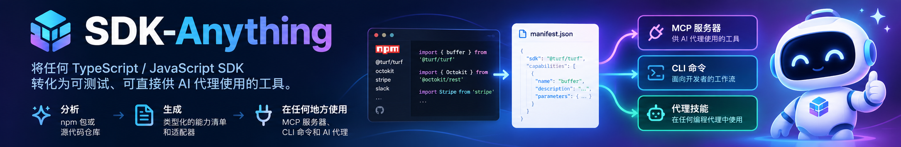

<p align="center">
  
</p>

<p align="center">
  <strong>今天的 SDK 服务人类开发者 👨‍💻。明天的调用者将是 AI 智能体 🤖。<br>
  SDK-Anything：连接 AI 智能体与全球软件库的桥梁</strong>
</p>

<p align="center">
  <a href="https://www.npmjs.com/package/sdk-anything"></a>
  <a href="https://github.com/janghotan/SDK-Anything/releases/tag/v0.1.0"></a>
  <a href="#-快速上手"></a>
  <a href="#-测试结果"></a>
  <a href="#-为什么需要-sdk-anything"></a>
  <a href="LICENSE"></a>
  <a href="README.md"></a>
</p>

<p align="center">
  
  
  
  
  
</p>

**单命令流水线**：将任何 TypeScript 或 JavaScript SDK 一键转化为 Claude Desktop、Cursor、Claude Code、OpenClaw、Codex、Windsurf 及自定义智能体可直接调用的专属工具。

<p align="center"><code>npm install -g sdk-anything</code></p>

---

## 🌟 为什么需要 SDK-Anything？

传统的 SDK 是专为人类程序员在 IDE 中阅读类型提示和自动补全而设计的。如果直接交给大语言模型（LLM），往往会导致上下文窗口溢出、敏感凭据泄露，甚至因误操作触发破坏性接口。

| 传统原始 SDK 的困境 | SDK-Anything 的 Agent-Native 解决方案 |
|---|---|
| **上下文窗口爆炸**<br>导出成百上千个辅助函数，迅速撑爆 LLM 提示词额度。 | **确定性原子工具集**<br>精选强类型操作，提供精炼的摘要描述和严格的 JSON Schema 输入参数。 |
| **误操作与意外副作用**<br>智能体可能盲目调用破坏性删除或高危扣费接口。 | **保守的副作用安全策略**<br>`pure`（纯计算）和 `read`（只读）默认启用；`write`、`destructive` 和 `unknown` 默认拦截禁用。 |
| **凭据与机密泄露风险**<br>API Token 被硬编码在提示词中或在错误堆栈中暴露。 | **仅引用机密模型 (Reference-Only)**<br>仅存储 `env:VAR_NAME` 引用；运行时引擎自动脱敏日志中所有的敏感 Token。 |
| **内存溢出与死循环**<br>无界的分页迭代器可能拉取数万条数据并导致进程崩溃。 | **强制有界截断**<br>严格限制单次调用的最大条目数（默认 100）和响应体积上限（1 MB）。 |
| **黑盒与不可审查的代码**<br>动态运行时代理或不安全的 `eval` 执行器。 | **透明可审查的 TypeScript**<br>生成干净、规范、无隐藏黑盒的标准 TypeScript 源代码。 |

---

## 🤖 智能体生态全面兼容

基于同一份能力清单（`sdk-anything/manifest/v1`），SDK-Anything 可同步生成三种维度的接入适配器：

```text
                           ┌──────────────────────────┐
                           │       SDK-Anything       │
                           │   统一能力清单 (v1 规范)    │
                           └────────────┬─────────────┘
                                        │
         ┌──────────────────────────────┼──────────────────────────────┐
         ▼                              ▼                              ▼
  🔌 官方 MCP 服务器             ⌨️ 开发者 CLI 命令              🤖 智能体专属技能
┌────────────────────────┐     ┌────────────────────────┐     ┌────────────────────────┐
│ Claude Desktop         │     │ 终端自动化脚本         │     │ Claude Code            │
│ Cursor                 │     │ Shell 管道工作流       │     │ Codex                  │
│ Windsurf               │     │ CI / CD 自动化         │     │ OpenClaw / Nanobot     │
└────────────────────────┘     └────────────────────────┘     └────────────────────────┘
```

| 智能体平台 | 集成协议 | 如何接入 |
|---|---|---|
| **Claude Desktop** | 官方 MCP Stdio 协议 | 添加到 `claude_desktop_config.json` |
| **Cursor / Windsurf** | 基于命令的 MCP 传输协议 | 添加到 `.cursor/mcp.json` |
| **Claude Code** | 原生生成器与使用技能 | 直接加载 `skills/sdk-anything/SKILL.md` |
| **OpenClaw / Codex / Pi** | 标准 Agent Skill 格式 | 直接复用生成的 `SKILL.md` 文档 |

---

## 🚀 快速上手

### 1. 安装

使用你惯用的包管理器安装已发布的 npm 包：

```bash
# npm
npm install -g sdk-anything

# pnpm
pnpm add -g sdk-anything

# Yarn Classic (v1)
yarn global add sdk-anything

# Yarn Berry (v2+)——无需全局安装即可运行
yarn dlx sdk-anything --help
```

也可以不全局安装，直接临时运行：

```bash
npx sdk-anything --help
```

<details>
<summary>或从源码构建</summary>

```bash
# 克隆代码仓库
git clone https://github.com/janghotan/SDK-Anything.git
cd SDK-Anything

# 安装依赖并编译构建
pnpm install
pnpm run build

# 全局软链接 CLI（可选）
pnpm link --global
```

</details>

### 2. 秒级静态分析任意 SDK

对公开 npm 包、本地工程目录或 GitHub 公开仓库进行静态审查，**绝不导入或执行目标包代码，严格跳过 npm 安装生命周期脚本**：

```bash
# 审查公开 npm 包
sdk-anything inspect npm:@turf/turf

# 审查本地 TypeScript/JavaScript SDK 仓库
sdk-anything inspect ./path/to/my-sdk

# 输出格式化的 JSON 证据数据
sdk-anything inspect npm:@turf/turf --json
```

终端输出示例：
```text
Resolved source: npm:@turf/turf
Kind:            npm
Version:         7.2.0
Digest:          sha256:196883847d5efc475a4c897753397199e1fabe332f631cf0202587a31bd17ffb
Entry point:     index.ts
Functions:       78 (distance, area, point, buffer, ...)
Classes:         0 (none)
Factories:       0 (none)
Unresolved:      0
```

### 3. 配置人工审查覆盖规则（可选）

针对需要配置构造函数参数、工厂方法或认证环境变量的 SDK：

```bash
sdk-anything inspect ./path/to/my-sdk --write-overrides
```

此命令将生成可编辑的 `sdk-anything.overrides.json`：
```json
{
  "schemaVersion": "sdk-anything/overrides/v1",
  "client": {
    "construction": "class",
    "export": "ApiClient",
    "options": {
      "apiKey": {
        "type": "secret",
        "source": "env:MY_SERVICE_API_KEY",
        "required": true
      }
    }
  },
  "operations": {
    "records.delete": {
      "effect": "destructive",
      "enabledByDefault": false
    }
  }
}
```

### 4. 生成 MCP 服务、CLI 与技能文档

```bash
# 一键生成完整项目到目标目录
sdk-anything generate npm:@turf/turf \
  --targets mcp,cli \
  --output ./generated/turf-tools

# 可选：启用兼容 OpenAI 的 AI 辅助生成更丰富的文档说明
sdk-anything generate npm:@turf/turf \
  --targets mcp,cli \
  --ai \
  --output ./generated/turf-tools

# 未发布或本地构建的 SDK：将构建产物复制进生成项目，并以相对 file: 依赖安装
sdk-anything generate ./path/to/my-sdk \
  --vendor-sdk ./path/to/my-sdk-dist \
  --output ./generated/my-sdk-tools

# 或显式指定依赖说明符
sdk-anything generate ./path/to/my-sdk \
  --sdk-dependency "file:../my-sdk-dist" \
  --output ./generated/my-sdk-tools
```

所有已发现的原子操作都会同时暴露给 CLI 与 MCP。纯函数/只读操作默认可用；写入、破坏性及未知副作用操作可被发现，但在显式授权前**故障闭锁**（CLI：`--allow-effects`、`--allow-operations`、`--allow-destructive`；MCP：`SDK_ANYTHING_ALLOWED_EFFECTS`、`SDK_ANYTHING_ALLOWED_OPERATIONS`、`SDK_ANYTHING_ALLOW_DESTRUCTIVE`）。

### 5. 静态验证、测试与健康诊断 (Doctor)

```bash
# 静态校验清单格式与命令一致性（无需任何容器）
sdk-anything validate ./generated/turf-tools

# 验证生成包的完整性、校验和及运行环境就绪度
sdk-anything doctor ./generated/turf-tools

# 本地受信代码：在净化的本地子进程中快速测试
sdk-anything test ./generated/turf-tools --trusted-local

# 不受信的第三方包：在完全隔离的容器沙箱中测试（环境缺失时故障闭锁）
sdk-anything test ./generated/turf-tools --sandbox
```

### 6. 安全重新生成与漂移检测

```bash
# 检查生成产物是否与 SDK 源代码发生漂移（只读，不修改磁盘）
sdk-anything generate npm:@turf/turf --output ./generated/turf-tools --check

# 安全重新生成：自动保护已被用户手工编辑的代码文件，防止意外覆盖
sdk-anything generate npm:@turf/turf --output ./generated/turf-tools

# 如需强制覆盖用户手工修改：
sdk-anything generate npm:@turf/turf --output ./generated/turf-tools --force
```

---

## 🎮 交互式演示

### 演示 A：通过生成的 CLI 调用并输出结构化 JSON 或管道输入

```bash
# 计算两个地理坐标点之间的测地线距离
$ sdk-cli-turf distance \
    --input '{"from":[-75.343, 39.984],"to":[-75.534, 39.123],"options":{"units":"miles"}}' \
    --json
60.37

# 支持通过标准输入 stdin 管道传递参数
$ echo '{"from":[-75.343, 39.984],"to":[-75.534, 39.123],"options":{"units":"miles"}}' | sdk-cli-turf distance --json
60.37

# 规范逃生舱口：通过全局唯一规范 ID 直接调用任何底层操作
$ sdk-cli-turf invoke distance --input '{"from":[-75.343, 39.984],"to":[-75.534, 39.123]}' --json
60.37

# 尝试调用未授权的写操作或破坏性操作会在执行前被立即拦截
$ sdk-cli-client deleteRecord --input '{"id":"item-123"}' --json
{
  "error": {
    "code": "POLICY_DENIED",
    "message": "Policy denied: operation 'deleteRecord' has effect 'destructive', which is disabled by default.",
    "suggestedAction": "Operation effect is restricted by default. Enable the effect class in invocation options or manifest overrides"
  }
}
```

### 演示 B：在 Claude Desktop 或 Cursor 中调用 MCP 工具

每个生成的 MCP 项目均自带预生成的 `claude_desktop_config.json`：
```json
{
  "mcpServers": {
    "turf-tools": {
      "command": "node",
      "args": ["./dist/server.js"]
    }
  }
}
```

大模型调用该工具时的实际通信格式：
```json
// 工具调用请求 (Request)
{
  "name": "distance",
  "arguments": {
    "from": [-75.343, 39.984],
    "to": [-75.534, 39.123],
    "options": { "units": "miles" }
  }
}

// 工具调用响应 (Response)
{
  "content": [
    {
      "type": "text",
      "text": "60.37"
    }
  ]
}
```

---

## 📊 测试结果

每个子系统在发布前均通过覆盖 21 个测试组（23 个 Vitest 文件）的严格自动化测试：

| 测试层级 | 验证目标 | 测试项 | 状态 |
|---|---|:---:|:---:|
| **CLI 核心入口** | 帮助文档、版本信息、退出码、分层配置解析 | 8 | ✅ 通过 |
| **安全源解析器** | npm 下载、本地目录、GitHub 归档、路径穿越 (`../`)、软链接逃逸 | 13 | ✅ 通过 |
| **依赖与重导出** | Re-exports 链条、Default 导出、聚合包、未解析符号提升 | 4 | ✅ 通过 |
| **依赖安全下载** | 有界、无生命周期脚本的 npm 依赖图物化与 semver 解析 | 6 | ✅ 通过 |
| **TypeScript 静态分析** | TS 编译器 AST、类型降级、枚举、索引签名、实用类型 | 6 | ✅ 通过 |
| **能力清单规范** | v1 Schema 校验、Ajv 语义检查、规范化字节稳定序列化、人工覆写、工厂客户端 | 9 | ✅ 通过 |
| **清单安全重新生成** | 文件校验和清单、`--check` 漂移检测、用户修改保护 | 5 | ✅ 通过 |
| **通用调用运行时** | 执行流水线、副作用安全拦截、敏感 Token 脱敏、请求超时控制 | 8 | ✅ 通过 |
| **MCP 代码生成器** | 官方 `@modelcontextprotocol/sdk`、系统指引嵌入、重名消歧、环境变量策略 | 5 | ✅ 通过 |
| **CLI 命令行生成器** | Commander.js 命令集、输入校验、stdin 流式管道、策略参数、`invoke` 逃生舱 | 8 | ✅ 通过 |
| **代理技能生成器** | 生成 `SKILL.md` 格式、命令一致性、禁用操作授权指引 | 3 | ✅ 通过 |
| **SDK 内嵌打包** | 项目根 `vendor/`、相对依赖说明符、包名校验、Node 20 安全清单加载 | 3 | ✅ 通过 |
| **AI 提案辅助层** | OpenAI 兼容接口 Mock、提示词注入隔离、隐私告知弹窗、优雅降级 | 6 | ✅ 通过 |
| **安全与执行沙箱** | 有状态客户端生命周期、回环测试服务、故障闭锁沙箱检测 | 5 | ✅ 通过 |
| **对抗性安全测试** | 压缩包穿越攻击、恶意软链接、解压炸弹、URL 凭据脱敏、循环游标拦截 | 9 | ✅ 通过 |
| **SDK 兼容性实验室** | 覆盖 6 种 SDK 架构形态的自动化验证（纯计算、认证客户端、Barrel、复杂类型、工厂、格式错误） | 2 | ✅ 通过 |
| **核心流程端到端测试** | 完整闭环：检查 → 清单 → 原子生成 → 进程级 CLI 与 MCP 工具执行（含 Turf 黄金用例） | 5 | ✅ 通过 |
| **独立性与黄金用例** | 零仓库反向引用、生成运行时独立编译 | 2 | ✅ 通过 |
| **安装包分发校验** | Tarball 内容白名单、安装后二进制执行、`doctor` 命令、可重定位打包 | 4 | ✅ 通过 |
| **性能与确定性** | 粗粒度预算、字节一致序列化、AbortSignal 取消 | 4 | ✅ 通过 |
| **外部生成项目验收** | 安装 Tarball → 内嵌 SDK → `npm install`/构建 → 真实 CLI 进程 + stdio MCP 客户端 | 6 | ✅ 通过 |
| **总计** | **23 个测试文件 100% 通过（0 项类型或 Lint 错误）** | **121** | **✅ 全部绿灯** |

---

## 🏗️ 系统架构流水线

```text
源定位符 (npm:包名, 本地目录, GitHub 公开仓库)
       │
       ▼
确定性静态分析器 (TypeScript Compiler AST & TypeChecker, noEmit)
       │
       ▼
证据清单 (函数签名、参数类型、文档注释、未解决项诊断)
       │
       ├─────────────────────────────────────────┐
       │ (可选)                                  │ (确定性)
       ▼                                         ▼
AI 提案辅助层 (OpenAI 兼容接口)             能力清单构建器 (v1 规范)
(自动生成摘要、分组、示例)                       │
       │                                         │
       └────────────────────┬────────────────────┘
                            ▼
                   人工审查覆盖引擎
                (sdk-anything.overrides.json)
                            │
                            ▼
                 已验证的标准能力清单
             (schema: sdk-anything/manifest/v1)
                            │
              ┌─────────────┴─────────────┐
              ▼                           ▼
        MCP 服务生成器              CLI 命令行生成器
       (Stdio 协议服务)            (Commander.js 命令行)
              │                           │
              └─────────────┬─────────────┘
                            ▼
                     通用运行时层
     (参数模式校验、副作用策略拦截、凭据管理、分页上限控制)
```

---

## 🔒 安全与沙箱设计原则

1. **静态审查阶段零执行保证：** 目标 SDK 在静态分析时绝不被导入或执行，严格规避安装钩子脚本。
2. **凭据仅引用模型：** 清单与代码中绝不写入明文密码或 Token，仅通过 `env:VARIABLE_NAME` 引用。
3. **自动化敏感信息脱敏：** 所有日志与异常追踪会自动将形如 `Bearer ...` 或环境变量中的密钥替换为 `[REDACTED]`。
4. **保守的默认副作用控制：** 仅 `pure` 与 `read` 默认放行；`write`、`destructive` 和 `unknown` 在未明确配置前运行时一律拦截。
5. **故障闭锁（Fail-Closed）容器沙箱：** 使用 `--sandbox` 必须依赖 Docker 或 Podman 环境。若缺失环境立即报错终止，**绝不静默降级为本地执行**。

---

## 📂 项目工程布局

```text
sdk-anything/
├── .github/workflows/ci.yml             # GitHub Actions 持续集成工作流
├── assets/                              # 项目横幅与视觉素材
│   ├── sdk-anything-banner-en.png
│   └── sdk-anything-banner-zh.png
├── docs/                                # 详尽设计文档
│   ├── architecture.md                  # 系统底层架构与模块规范
│   ├── design.md                        # 产品与架构设计
│   ├── security.md                      # 安全模型、信任边界与沙箱策略
│   └── release-evidence.md              # 经验证的发布证据与已知边界
├── examples/                            # 经过真实测试的参考范例
│   ├── turf/                            # 纯函数黄金范例
│   └── client-sdk/                      # 有状态的网络客户端 SDK 范例
├── schema/
│   └── capability-manifest.schema.json  # Manifest v1 JSON Schema 定义
├── skills/
│   └── sdk-anything/SKILL.md            # 宿主编码智能体编排技能
├── src/
│   ├── cli/                             # CLI 命令、入口与配置
│   ├── source/                          # 安全的 npm、本地与 GitHub 解析器
│   ├── analyzer/                        # TS 编译器 AST 分析与类型降级
│   ├── manifest/                        # 清单构建、模式校验与覆盖引擎
│   ├── runtime/                         # 通用运行时、安全拦截器与凭据管理
│   ├── generators/                      # MCP 服务、CLI 与 SKILL.md 生成器
│   ├── ai/                              # 可选 AI 提案客户端与隐私告知
│   └── sandbox/                         # 静态检测与容器执行沙箱
└── tests/                               # 23 组 Vitest 自动化测试套件 (121 项测试)
```

---

## 🤝 社区贡献

我们热烈欢迎来自社区的贡献与反馈！
- **提交新型 SDK 模式：** 如果您遇到具有独特构造模式的 SDK，欢迎提交 Issue 或 PR 补充测试夹具。
- **扩展生成适配器：** 协助适配更多主流智能体框架与运行时环境。
- **安全审计与加固：** 协助对归档解压与容器沙箱边界进行持续强化。

---

<p align="center">
  <strong>SDK-Anything</strong> — <em>让全球所有软件库皆可 Agent-Native 化。</em><br>
  <sub>专为自主 AI 智能体时代打造 • 121 项自动化测试通过 • 100% 确定性保证</sub>
</p>
