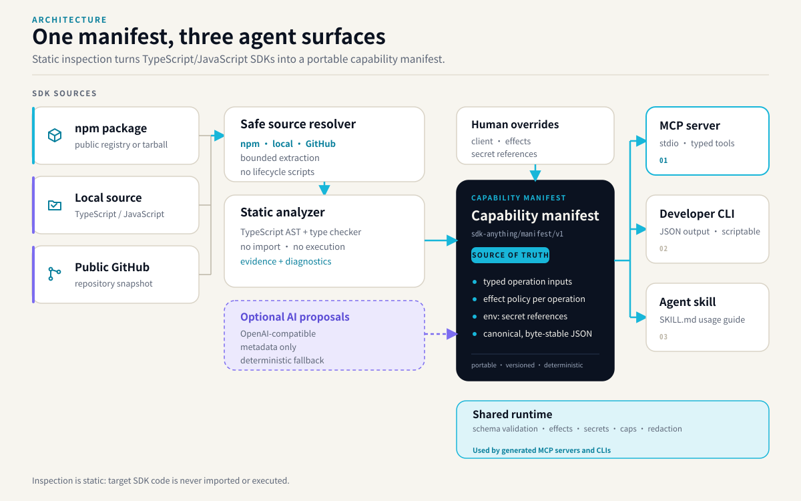

# SDK-Anything v0.1 Architecture

## 1. System Pipeline

SDK-Anything converts TypeScript/JavaScript SDKs into inspectable, testable, agent-friendly atomic MCP servers, CLIs, and consumer skills from a single versioned capability manifest.

The capability manifest is the single source of truth. Inspection is static: target SDK code is never imported or executed. Generated MCP servers and CLIs share the runtime policy layer described in [security.md](security.md). The diagram source and regeneration instructions live in [`assets/README.md`](../assets/README.md).

## 2. Logical Modules

1. **Source Resolver (`src/source/`)**:
   - Normalizes `npm:<package>`, local directory paths, and `https://github.com/<owner>/<repo>`.
   - In-memory archive decompression with path traversal rejection (`../`, leading `/`) and symlink verification.
   - Computes deterministic tree content digest (`sha256:<hex>`).
   - Never executes package scripts (`prepare`, `postinstall`).

2. **TypeScript Static Analyzer (`src/analyzer/`)**:
   - Programmatic TypeScript Compiler API host (`ts.createProgram`) with `noEmit: true`.
   - Inspects entry point exports without executing or importing modules into the generator process.
   - Converts primitive, literal, union, enum, array, and object types to JSON Schema Draft 2020-12.
   - Circular references and unbound generics are detected and recorded as `unresolved`.

3. **Capability Manifest Engine (`src/manifest/`)**:
   - Schema: `schema/capability-manifest.schema.json` (`sdk-anything/manifest/v1`).
   - Ajv validator with semantic policy enforcement.
   - Conservative effect inference (`pure`, `read`, `write`, `destructive`, `unknown`).
   - Human overrides engine (`applyOverrides`, `generateStarterOverrides`).
   - Byte-stable canonical JSON serializer (`serializeCanonicalManifest`).

4. **Shared Invocation Runtime (`src/runtime/`)**:
   - Single point of execution for both MCP server and CLI adapters.
   - Client lifecycle instantiation (`none`, `class`, `factory`).
   - Secret resolution from environment references (`env:VAR_NAME`), never static values.
   - Schema validation before invocation.
   - Policy enforcer blocking write/destructive/unknown operations unless explicitly permitted.
   - Result pagination and byte size caps (1MB default cap).
   - Error normalization and secret token redaction.

5. **Code Generators (`src/generators/`)**:
   - **MCP Generator (`src/generators/mcp/`)**: Generates official `@modelcontextprotocol/sdk` TypeScript server.
   - **CLI Generator (`src/generators/cli/`)**: Generates Commander.js CLI with `--json` support.
   - **Consumer Skill Generator (`src/generators/consumer-skill/`)**: Generates consumer `SKILL.md` detailing tool usage and composition instructions.

6. **Optional AI Proposal Layer (`src/ai/`)**:
   - OpenAI-compatible HTTP client using standard `fetch`.
   - Explicit privacy disclosure before transmission.
   - Prompt-injection defenses: treats SDK code, comments, and README as untrusted data.
   - Validates model output against known evidence symbol IDs.

7. **Sandbox & Test Harness (`src/sandbox/`)**:
   - Static verification (schema, compilation, parity) without containers.
   - Container sandbox runner (`--sandbox`) requiring Docker or Podman, failing closed when missing.
   - Best-effort trusted-local runner (`--trusted-local`) running in sanitized child processes.
