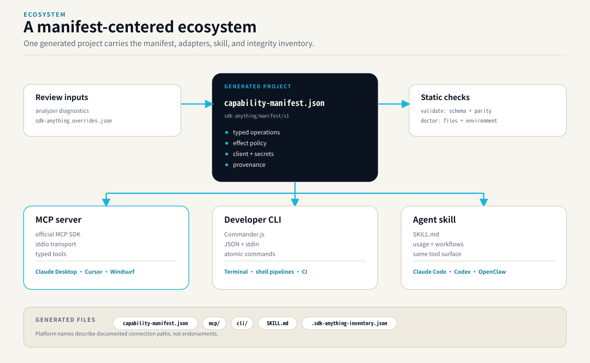

# SDK-Anything — Product and Architecture Design

**Status:** Revised draft for founder review  
**Date:** 2026-10-18  
**Version target:** v0.1  
**Project type:** Open-source developer tool  

## 1. Product statement

SDK-Anything turns supported TypeScript/JavaScript SDKs into inspectable, testable, agent-friendly operations. From one SDK analysis and one versioned capability manifest, it generates both:

- a runnable Model Context Protocol (MCP) server; and
- a developer-friendly CLI with machine-readable JSON output.

It also emits a generated `SKILL.md` that explains how a consuming agent should discover and use the resulting capabilities. The generator itself can be orchestrated by an agent Skill or run directly through a standalone CLI.



The product is not “expose every function as an LLM tool.” It combines deterministic API extraction with optional AI-assisted descriptions and operation selection, then validates the manifest and generated artifacts before reporting them as ready. In v0.1, generated capabilities are atomic operations, not multi-step executable composites; the generated Skill can teach the consuming agent how to combine atomic tools.

## 2. Intended users and first use case

SDK-Anything may eventually serve three groups:

1. **AI agent developers** who need to give an agent access to an SDK without hand-writing every tool integration.
2. **SDK maintainers** who want to ship an agent-ready interface beside their SDK.
3. **Organizations with internal SDKs** that need tools generated from proprietary packages while keeping source code on their own machines.

### v0.1 primary user

For v0.1, optimize for an AI agent developer generating tools from a public TypeScript package or a local source repository. The architecture should not prevent SDK maintainers or internal teams from using it, but their advanced needs are not the first acceptance target.

### First end-to-end example

Use two complementary proving grounds:

1. **`@turf/turf`** is the golden test for static export/type extraction, deterministic operation generation, JSON-compatible inputs/outputs, and reproducible tests. It is deliberately the easy case, not sufficient evidence that the product handles typical service SDKs.
2. **A local client-SDK fixture** is the architecture test. It must expose a class/factory-based client with constructor configuration, a credential supplied by environment-variable reference, asynchronous HTTP calls, paginated responses, and representative HTTP/authentication errors. Its tests use a loopback fixture server and synthetic credentials, never a real third-party account.

The fixture proves the manifest and runtime can represent stateful network clients before the schema is locked. A real SDK such as Octokit may be used as a follow-up compatibility spike, but is not required to claim broad real-world support in v0.1.

Neither example is a claim that all SDK patterns are supported; unsupported or ambiguous patterns must be reported explicitly.

## 3. Problem and product thesis

SDKs often expose methods designed for conventional application developers. Agents need a discoverable, typed interface with concise descriptions, constrained inputs, understandable outputs, usage guidance, and predictable errors. Exposing every method verbatim can overwhelm agents; hand-curating an integration for each SDK does not scale.

SDK-Anything is not intended to replace OpenAPI-to-MCP converters for clean, documented HTTP APIs. Its intended advantage is preserving and making explicit SDK-level behavior that an OpenAPI document may not capture: client construction, authentication strategies, custom request logic, signing, retries, pagination helpers, local-only or proprietary abstractions, and SDK-specific error behavior. These behaviors must be extracted from evidence or supplied through explicit user configuration—not guessed by AI. For a simple REST API where an OpenAPI converter already works well, that converter may be the better tool.

SDK-Anything's thesis is that a reusable pipeline can turn SDKs into better agent interfaces if it:

- extracts facts from types and source deterministically;
- uses an AI model only to help interpret documentation and propose useful capabilities;
- records capabilities in a versioned, portable manifest;
- generates multiple interfaces from that single manifest; and
- validates both the definitions and the generated code before claiming success.

## 4. Design principles

1. **Evidence before inference.** Function names, signatures, exports, and type facts must be traceable to the inspected source. AI-generated descriptions and compositions are proposals, not facts.
2. **One source of truth.** MCP tools, CLI commands, operation policy, tests, and the generated skill must derive from the same manifest.
3. **Inspectable output.** Generate real TypeScript source code in addition to the manifest. Developers must be able to read, edit, test, and commit the output.
4. **Safe by default.** Inspecting source must not execute it. Potentially side-effecting operations must not become executable merely because the analyzer discovered them.
5. **Reproducibility.** The same source revision, configuration, and generator version should produce stable manifest and generated files, excluding explicitly volatile metadata.
6. **Progressive capability.** Deterministic wrapper generation works without an AI key. AI assistance adds descriptions and higher-level capability proposals.
7. **Small first release.** One language ecosystem, two output adapters, one canonical manifest, and a narrow first example. No hosted platform is required for v0.1.

## 5. v0.1 scope

### In scope

- TypeScript and JavaScript SDKs.
- Input from an npm package, a local source directory, or a public GitHub repository. For private repositories, the supported path is a local checkout; SDK-Anything should not collect or store GitHub credentials in v0.1.
- Deterministic extraction of public exports, signatures, TypeScript types, JSDoc, package metadata, and available examples.
- Optional AI assistance via a configurable OpenAI-compatible endpoint for operation descriptions, operation selection, and documentation interpretation; AI does not generate executable composite workflows in v0.1.
- A Skill file that lets a compatible coding agent orchestrate the SDK-Anything workflow using its existing model.
- A versioned JSON capability manifest.
- Generated, inspectable TypeScript source for an MCP server and a CLI.
- Shared validation and operation-policy enforcement across MCP and CLI.
- Generated test fixtures and validation tests.
- Opt-in test execution in an isolated, restricted sandbox when a supported sandbox runtime is available.
- A generated `SKILL.md` that explains available capabilities, parameters, effects, and known limitations to a consuming agent.
- A complete, reproducible `@turf/turf` golden example plus a local client-SDK fixture for constructor/configuration, auth references, asynchronous HTTP, pagination limits, and error handling.
- A file-based override mechanism for resolving ambiguous SDK patterns and types without hand-editing generated source.

### Explicitly out of scope for v0.1

- Python, Java, Go, Rust, or other-language analyzers.
- A hosted web application, SaaS dashboard, user accounts, billing, hosted execution, or a hosted SDK registry.
- Automatically publishing generated MCP servers or packages to public registries.
- Automatic deployment or cloud provisioning.
- General-purpose arbitrary code generation or `eval`-based execution.
- Composite capabilities or generated multi-step workflows; agents may compose approved atomic tools at runtime.
- Automatic support for arbitrary async iterators, streams, or complex pagination patterns when the analyzer cannot establish safe bounded behavior.
- Private-repository credential management.
- A community marketplace, ratings system, or certification badge.
- Guaranteeing that generated tools are universally safe or that AI-proposed workflows are always correct.

## 6. User workflows

### Workflow A: inspect a package or repository

```bash
sdk-anything inspect npm:@turf/turf
sdk-anything inspect ./path/to/sdk
sdk-anything inspect https://github.com/org/public-sdk
```

Inspection performs static analysis only. It does not run package scripts, import the target package into the SDK-Anything process, or execute generated code. It produces a summary of discovered exports, signatures, constructor/factory patterns, configuration requirements, documentation coverage, unresolved types, possible side effects, pagination/return-shape patterns, and source provenance.

A public GitHub URL may be downloaded as a source snapshot for analysis. If a project requires a build step to expose its API, the tool reports that limitation and suggests a local checkout/build workflow; it does not run an arbitrary build automatically.

For signatures or client patterns that cannot be resolved deterministically, `sdk-anything inspect --write-overrides <source>` emits a starter `sdk-anything.overrides.json`. The user can provide reviewed schemas, constructor/factory choice, method receiver paths, credential environment-variable references, or a bounded pagination adapter. Overrides are validated and recorded in manifest provenance; they do not modify the inspected source or generated files invisibly.

### Workflow B: generate MCP and CLI outputs

```bash
sdk-anything generate npm:@turf/turf \
  --targets mcp,cli \
  --output ./generated/turf-tools
```

The generator creates a self-contained generated project with the manifest, adapters, tests, and usage instructions. The target SDK version is pinned in the generated project's dependency metadata so outputs do not silently drift to a newer SDK version.

### Workflow C: use AI-assisted generation

```bash
sdk-anything generate npm:@turf/turf \
  --targets mcp,cli \
  --ai \
  --output ./generated/turf-tools
```

The user configures an OpenAI-compatible endpoint, model name, and API key through environment variables or local configuration. The CLI explains what source-derived information will be sent before the first AI-assisted run. Deterministic inspection, manual overrides, manifest validation, and basic atomic generation remain usable without a model key.

### Workflow D: validate and test

```bash
sdk-anything validate ./generated/turf-tools
sdk-anything test ./generated/turf-tools --sandbox
```

Static validation is deterministic and never requires a container. It validates source-derived schemas, manifest references, generated TypeScript, and adapter parity without executing target code. Execution tests are a separate command and mode: untrusted or remotely obtained code requires a supported OS/container sandbox; a clearly labelled `--trusted-local` mode may run user-owned local source in a child process with a sanitized environment, but is not represented as a security sandbox. There is no silent fallback between modes.

### Workflow E: invoke generated capabilities

Generated CLI and MCP adapters call the same operation implementations and apply the same schema validation and permission policy. CLI commands support human-readable output and `--json`; errors use stable error codes and non-zero exit codes. MCP tool names, schemas, descriptions, and outcomes derive from the manifest.

## 7. Architecture

### 7.1 Pipeline

```text
Source locator
  -> Source resolver (npm package / local directory / public GitHub snapshot)
  -> TypeScript/JavaScript analyzer
  -> Evidence inventory (exports, types, docs, provenance)
  -> Optional AI proposal stage
  -> Capability manifest
  -> Manifest validation and policy checks
  -> TypeScript code generation
       -> MCP adapter
       -> CLI adapter
       -> consumer SKILL.md
  -> Static validation and generated tests
  -> Optional sandboxed test execution
```

The source resolver and analyzer must not execute source files. The AI proposal stage is isolated from code execution and returns structured proposals against known operation identifiers. The manifest validator rejects references to operations or fields that were not discovered or explicitly approved.

### 7.2 Logical modules

- **CLI shell:** argument parsing, configuration, progress, exit codes, and human/JSON summaries.
- **Source resolver:** normalizes package, local directory, and repository inputs; pins source revision/version; records a content digest.
- **TypeScript analyzer:** uses the TypeScript compiler API and package metadata to discover public exports, signatures, overloads, JSDoc, declaration files, class/factory patterns, and provenance.
- **Evidence inventory:** a normalized, deterministic internal representation of source facts. It separates facts from AI suggestions.
- **Client lifecycle resolver:** describes client construction, required configuration, credential references, receiver/call paths, and teardown hooks where supported. Ambiguous lifecycle patterns require explicit overrides instead of an AI guess.
- **AI provider adapter:** a small provider interface with an OpenAI-compatible HTTP implementation for standalone mode. Agent Skill mode can use the host agent's model instead of making a second model request.
- **Operation planner:** selects and describes supported atomic operations. It does not generate multi-step composites in v0.1.
- **Manifest package:** JSON Schema, versioning, canonical serialization, migration rules, validation, and diagnostics.
- **Generators:** templates and source generation for MCP and CLI interfaces.
- **Shared runtime:** parameter validation, invocation, output serialization, error normalization, and permission checks.
- **Test generator/runner:** deterministic fixture generation, static checks, and opt-in sandbox execution.
- **Skill artifacts:** one SDK-Anything orchestration skill for the generator and one generated consumer `SKILL.md` per output project.

The initial implementation may live in one repository and one npm package, but these modules should have explicit interfaces and be independently unit-testable. Do not split into separately published packages until there is a real consumer for that separation.

## 8. Capability manifest

The manifest is the central product artifact and must be versioned from the first release. The first schema identifier is provisionally `sdk-anything/manifest/v1`.

A minimal illustrative fragment shows the important shape. It is explanatory pseudodata, not the final JSON Schema:

```json
{
  "schemaVersion": "sdk-anything/manifest/v1",
  "source": {
    "package": "example-client",
    "version": "1.2.3",
    "digest": "sha256:..."
  },
  "client": {
    "module": "example-client",
    "export": "Client",
    "construction": "class",
    "options": {
      "baseUrl": { "type": "string", "source": "env:EXAMPLE_BASE_URL", "required": false },
      "token": { "type": "secret", "source": "env:EXAMPLE_TOKEN", "required": true }
    }
  },
  "operations": [
    {
      "id": "records.get",
      "invoke": { "kind": "instance-method", "receiver": "records", "method": "get" },
      "inputSchema": {
        "type": "object",
        "properties": { "id": { "type": "string" } },
        "required": ["id"],
        "additionalProperties": false
      },
      "result": { "mode": "direct" },
      "effect": "read",
      "enabledByDefault": true
    }
  ]
}
```

The exact field names will be finalized in the schema. The contract must distinguish client construction from individual operations, keep credentials as references rather than values, and make result/pagination behavior explicit. A `receiver` path is declarative data validated against extracted symbols or an approved override; it must not be evaluated as arbitrary source text.

At minimum, the manifest contains:

- schema version and generator version;
- source identity, exact package version or repository revision, and source digest;
- SDK package name and entry point where known;
- atomic operation IDs and stable tool names;
- operation summary, detailed description, source provenance, and confidence/evidence notes;
- JSON Schema for inputs and outputs, including required fields and enums when known;
- client lifecycle and configuration descriptor: module/export, construction mode (`none`, `class`, or `factory`), typed non-secret options, credential references such as environment-variable names, and explicit evidence/override provenance;
- operation invocation descriptor: top-level function or instance method, validated receiver/call path, async result mode, and relevant output normalization;
- pagination/stream descriptor: `none`, bounded page/cursor, async iterator, or stream; unsupported/unbounded handling is explicit and never silently consumes all results;
- effect classification: `pure`, `read`, `write`, `destructive`, or `unknown`;
- permissions and default-enabled status;
- unresolved type, lifecycle, pagination, or documentation questions and explicit limitations;
- user overrides applied to unresolved or ambiguous source facts;
- test cases and expected behavior where verifiable.

### Atomic operation rules

An atomic operation maps to a discovered SDK function or instance method through an explicit call descriptor. Every generated input schema must be justified by TypeScript types, JSDoc, a known schema, or explicit human approval. AI cannot silently invent required parameters, defaults, enum values, constructor behavior, pagination semantics, or output guarantees.

Operations remain unresolved and unavailable for execution when input/output types, client construction, receiver paths, or response handling cannot be established. Users can resolve gaps through `sdk-anything.overrides.json`; overrides are schema-validated, versioned, included in provenance, and never written into generated code invisibly.

### Client lifecycle and configuration

The schema must distinguish module-level functions from instance methods. For supported client-based SDKs it records how a client is created, which non-secret options are configurable, where credentials are sourced, and how each operation is called on that client. Secrets are represented only by references (for example, `env:GITHUB_TOKEN`) and never copied into the manifest, generated files, AI prompts, logs, or fixture artifacts.

A user must be able to inspect or edit the override file for ambiguous constructors, factories, receiver paths, or schema gaps. The generator must not infer an arbitrary call path from AI output and then execute it without deterministic validation and explicit review.

### Pagination and results

The manifest describes whether an operation returns a direct value, one page, a bounded collection, an async iterator, or a stream. In v0.1, direct results and explicitly configured bounded page/cursor operations are supported. The runtime enforces a maximum item count and response-size limit for paginated results. Async iterators or streams without a declared bounded adapter remain unresolved and unavailable rather than being fully consumed by default.

### No composites in v0.1

SDK-Anything v0.1 generates atomic operations only. It may organize operations into groups and provide agent-friendly descriptions, examples, and usage guidance. It does not emit executable multi-step composites. The generated consumer Skill explains how an agent can combine atomic tools during its own reasoning, with normal permission checks applied to each call. Composite workflow generation may be reconsidered after usage evidence in a later release.

### Determinism and versioning

Manifest serialization uses stable key ordering and stable operation ordering. Volatile timestamps are excluded from the canonical digest. Breaking schema changes require a new manifest major version; non-breaking optional fields may be added compatibly. The generated project records both the manifest version and generator version.

## 9. MCP and CLI generation

### Shared semantics

MCP and CLI adapters must not independently implement operation logic. They call a shared generated invocation layer that validates inputs against the manifest, checks policy, executes the known SDK operation, normalizes errors, and serializes results.

### MCP adapter

- Use the official TypeScript MCP SDK.
- Expose one tool per enabled atomic operation.
- Derive tool names, descriptions, and schemas from the manifest.
- Create or reuse the configured SDK client at runtime using the manifest's client lifecycle descriptor.
- Resolve credentials from configured environment variables or secret references; never accept secret values as ordinary model-supplied tool arguments by default.
- Enforce pagination item/byte caps and operation timeouts.
- Do not expose unresolved operations as executable tools.
- Apply the same policy checks as the CLI.
- Return structured errors that distinguish invalid input, unavailable capability, denied action, SDK failure, timeout, and unexpected runtime failure without leaking secrets.

### CLI adapter

- Generate predictable commands from stable operation IDs.
- Provide `--json` output and stable non-zero exit codes for errors.
- Validate all inputs before invoking the SDK.
- Initialize the same SDK client configuration used by the MCP adapter.
- Enforce pagination item/byte caps and operation timeouts.
- Require explicit enablement for write-capable operations; require stronger explicit enablement and interactive confirmation for destructive actions when running interactively.
- Never print credential values. Redact configured secret fields and sensitive response fields where metadata marks them sensitive.

### Generated consumer skill

Each generated project includes a `SKILL.md` summarizing its capabilities, intended use, required configuration, permission levels, examples, and known limitations. It teaches an agent how to choose and call the generated tools; it is not an instruction to bypass runtime permission checks.

## 10. AI-assisted generation

AI is an optional proposal layer, not a trusted source of type facts or executable code.

### Standalone CLI mode

- Use a configurable OpenAI-compatible endpoint and model.
- Keep API keys in environment variables or local user configuration; never store them in generated files or manifests.
- Send only the minimum relevant extracted signatures, documentation snippets, and examples needed for the request.
- Before the first AI-assisted run, disclose that these selected materials may be sent to the configured model endpoint. Never silently upload an entire private repository.
- Treat all source text and documentation as untrusted data. Instructions contained in a README, JSDoc, code comments, or package metadata must not override SDK-Anything's system instructions or security policy.
- Require schema-constrained structured output; reject malformed suggestions and validate every referenced operation.
- Do not use AI output as executable code. AI output may suggest operation descriptions, groupings, examples, and which discovered atomic operations are worth exposing; all suggestions are validated against deterministic evidence. It cannot create executable multi-step composites in v0.1.

### Agent Skill mode

The orchestration Skill invokes SDK-Anything CLI commands for deterministic work and uses the host agent model for interpretation and capability proposals. The Skill follows the same output schema and approval rules as standalone mode. It must not assume that a host agent's permissions authorize executing the target SDK.

## 11. Security and execution policy

### Static analysis defaults

- Inspection never imports or executes the target package.
- Package installation lifecycle scripts are not run by default.
- Path handling must reject archive/path traversal and unsafe output paths.
- Source content and AI proposals are untrusted inputs.
- Generated files must not include API keys, copied environment secrets, or credential values.

### Effect classification and default policy

Classifications are `pure`, `read`, `write`, `destructive`, and `unknown`.

- `pure` and verified `read` operations may be enabled by default.
- `write` operations are generated but disabled until explicitly enabled in policy/configuration.
- `destructive` operations remain disabled unless separately enabled; CLI use requires an additional confirmation for interactive execution.
- `unknown` operations are disabled until reviewed and reclassified or supplied an explicit policy decision.
- Classification uncertainty must be visible in inspection output and manifest metadata.

Static analysis cannot perfectly infer semantic side effects. The policy is therefore conservative: a model-generated description cannot promote an unknown operation to a lower-risk class without evidence and user approval.

MCP clients may not offer an interactive confirmation UI. In that case, policy is enforced by the generated server configuration and allowlist; tool descriptions or model instructions alone are not sufficient safeguards.

### Verification tiers and opt-in execution

Static verification is always available without Docker/Podman and never executes the target package. It includes schema validation, TypeScript compilation of generated files, import/reference checks, generated adapter parity, and deterministic checks that do not require running untrusted code.

Execution testing is off by default and has distinct modes:

- **`--sandbox`**: for package code that is not fully trusted. Requires a real supported OS/container isolation boundary (v0.1 target: Docker or Podman). Use an ephemeral container, no network by default, no inherited host credentials or environment, no lifecycle scripts by default, read-only source mount where practical, and a temporary output mount. Loopback fixture services may be allowed within the isolated test harness without enabling general outbound network.
- **`--trusted-local`**: optional convenience for source the user owns and trusts. Runs a child process with a minimal allowlisted environment and temporary working directory. Node's Permission Model may be used as defense in depth where compatible, but Node explicitly states it does not provide a security boundary against malicious code. This mode must be labelled as trusted-code execution, never as a sandbox.
- **No automatic fallback**: if `--sandbox` is requested and its runtime is unavailable, the command fails with an actionable message. It never silently switches to `--trusted-local`.

The CLI clearly distinguishes “static checks passed,” “tests not run,” “trusted local test passed,” and “sandboxed test passed.” SDKs that require live external network access or secrets to test are reported as not fully sandbox-verified in v0.1; fixtures and dependency injection should be used where feasible.

## 12. Errors, validation, and test strategy

The engine should report failures at the stage where they occur: source resolution, package metadata parsing, type extraction, AI proposal parsing, manifest validation, generation, static validation, sandbox setup, or runtime invocation. Errors must identify the relevant source symbol or generated artifact where possible, with a suggested corrective action.

### Required test layers

1. **Unit tests:** source normalization, type-to-schema conversion, manifest parsing, policy rules, stable serialization, and operation-name generation.
2. **Golden tests:** the same fixture source and configuration produce stable manifests and generated files.
3. **Generator tests:** generated MCP and CLI adapters expose the same enabled operations, validate the same inputs, enforce the same policy, and normalize errors consistently.
4. **Negative tests:** incomplete TypeScript types, complex utility types, overloaded functions, circular types, unsupported signatures, malicious documentation instructions, path traversal, schema-invalid AI suggestions, ambiguous client initialization, and unknown effects.
5. **Client-SDK fixture tests:** class/factory construction, environment-based credential references, async HTTP success/failure, unauthorized responses, bounded pagination, response-size limits, and safe error redaction.
6. **Sandbox tests:** no network by default, no inherited credentials, no package lifecycle scripts by default, clear status when tests are skipped, and no fallback to trusted host execution when the sandbox runtime is absent.
7. **Turf end-to-end demo:** generate operations, validate the manifest, verify representative results, and invoke at least one operation through both CLI and MCP.

Passing generated tests means the tested cases passed in that environment; it is not a guarantee that the SDK or generated capability is universally safe or correct.

## 13. Proposed repository layout

```text
sdk-anything/
├── README.md
├── LICENSE
├── package.json
├── tsconfig.json
├── skills/
│   └── sdk-anything/
│       └── SKILL.md
├── schema/
│   └── capability-manifest.schema.json
├── templates/
│   ├── mcp/
│   ├── cli/
│   └── consumer-skill/
├── src/
│   ├── cli/
│   ├── source/
│   ├── analyzer/typescript/
│   ├── evidence/
│   ├── ai/
│   ├── capabilities/
│   ├── manifest/
│   ├── generators/
│   ├── runtime/
│   ├── policy/
│   └── sandbox/
├── tests/
│   ├── unit/
│   ├── golden/
│   ├── security/
│   ├── fixtures/
│   │   └── client-sdk/
│   └── e2e/
├── examples/
│   ├── turf/
│   └── client-sdk/
└── docs/
    ├── architecture.md
    └── security.md
```

This is a proposed logical layout, not an existing repository. Implementers may consolidate very small modules, but should preserve the boundaries between analysis, AI suggestions, manifest validation, policy, and output adapters.

## 14. Acceptance criteria for v0.1

The first release is acceptable when all of the following are demonstrated:

1. `sdk-anything inspect npm:@turf/turf` completes without executing target package code or requiring an AI key.
2. `sdk-anything inspect ./path/to/sdk` analyzes a representative local TypeScript/JavaScript SDK; a public GitHub repository can be resolved without executing its project scripts.
3. `sdk-anything inspect --write-overrides <source>` can produce a human-editable `sdk-anything.overrides.json` to resolve unsupported/ambiguous input schemas, client factories, receiver paths, credential references, and pagination behavior.
4. `sdk-anything generate ... --targets mcp,cli` creates a generated project with a versioned manifest, inspectable TypeScript source, CLI adapter, MCP adapter, tests, and consumer `SKILL.md`.
5. Both adapters are generated from the same manifest and share client initialization, input validation, pagination limits, error normalization, and policy behavior.
6. The capability manifest models module-level functions and class/factory-based clients, including client options, credential references, method receiver paths, async results, and bounded pagination.
7. A synthetic client-SDK fixture demonstrates constructor configuration, authentication via an environment-variable reference, async HTTP, pagination caps, and normalized errors using a loopback test service.
8. AI assistance can be enabled with an OpenAI-compatible endpoint; if unavailable or malformed, the CLI reports a clear error and retains any deterministic artifacts that were validly produced.
9. SDK-Anything supports usable deterministic inspection, override editing, manifest validation, and basic generation without AI credentials.
10. No multi-step composite capabilities are generated in v0.1. The generated Skill provides usage examples for chaining atomic tools in the consuming agent.
11. Writes, destructive operations, and unknown-effect operations are disabled by default, and runtime checks—not prompts alone—enforce this policy.
12. Static verification works without a container. Untrusted-code execution tests require an explicit sandbox, avoid network and secrets by default, and never fall back silently. Trusted-local execution is clearly labelled and is not claimed to be a security sandbox.
13. The Turf example demonstrates at least one representative operation through both generated interfaces and verifies expected output against deterministic fixtures.
14. Documentation explains current limitations, supported SDK patterns, override workflows, client lifecycle and pagination support, generated artifacts, security boundaries, and the difference between “generated,” “validated,” and “tested.”

## 15. Risks and mitigations

- **The Turf example masks real client SDK complexity.** Mitigation: retain Turf as a pure-function golden test and require a client-SDK fixture that covers construction, auth refs, async HTTP, pagination caps, and failures before claiming the manifest is ready for general SDKs.
- **TypeScript type extraction is imperfect.** Mitigation: retain unresolved types, generate an editable override file, and do not emit unresolved operations as enabled tools.
- **Client lifecycle is ambiguous in many SDKs.** Mitigation: model factory/class construction explicitly and require overrides when constructors, receiver paths, or config cannot be established from source evidence.
- **Pagination can return unbounded data.** Mitigation: declare pagination/result modes, enforce count and byte caps, and leave streams or iterators unresolved if safe bounded handling cannot be established.
- **AI creates plausible but incorrect abstractions.** Mitigation: AI may propose descriptions and operation selection only; no executable composite workflows in v0.1. Generated tool inputs remain grounded in deterministic evidence or explicit overrides.
- **SDK effects cannot always be inferred.** Mitigation: conservative `unknown` classification, disabled-by-default policy, and explicit configuration.
- **Source documentation may contain prompt injection.** Mitigation: treat all inspected text as untrusted data; constrain model output and validate it deterministically.
- **Sandbox support varies by platform.** Mitigation: keep static verification independent; require OS/container isolation for untrusted execution; offer clearly labelled trusted-local execution only for code the user owns; never call Node permission flags or worker threads a sandbox.
- **SDK-Anything overlaps with OpenAPI-to-MCP.** Mitigation: state that the tool's value is preserving SDK-native client configuration, authentication, signing, retries, pagination helpers, local/proprietary code, and SDK-specific errors—only where supported and evidenced. Recommend OpenAPI conversion when it is the better fit.
- **The product is too broad for v0.1.** Mitigation: TypeScript/JavaScript only, MCP + CLI only, no hosted product, no auto-publishing, atomic operations only, Turf plus one client fixture.

## 16. Decisions recorded

- **Long-term audience:** AI agent developers, SDK maintainers, and organizations with internal SDKs; v0.1 optimizes for AI agent developers.
- **Inputs:** npm package, local source repository, and public GitHub source snapshot; private repository support uses a local checkout.
- **Analysis:** deterministic static analysis plus optional AI assistance.
- **Outputs:** generated MCP server and CLI, derived from a single manifest; include a consumer `SKILL.md`.
- **Internal representation:** versioned portable capability manifest, plus generated source adapters.
- **First demos:** `@turf/turf` as pure-function golden test; a synthetic local client SDK fixture as the client-lifecycle/network test. An actual service SDK is a later compatibility spike.
- **Capability model:** typed, agent-friendly atomic operations only in v0.1; no generated composites or multi-step workflows.
- **Client support:** model class/factory construction, credential references, per-operation receiver paths, async results, bounded pagination, timeouts, and normalized failures. Unsupported patterns remain unresolved.
- **Schema refinement:** generate a versioned, editable `sdk-anything.overrides.json` for schema gaps and ambiguous lifecycle/operation mappings.
- **Languages:** TypeScript/JavaScript only.
- **Product interface:** local-first CLI; hosted UI deferred.
- **Generation modes:** host-agent Skill orchestration and standalone AI-enabled CLI.
- **Standalone model integration:** configurable OpenAI-compatible endpoint; AI is optional for deterministic analysis and basic generation.
- **Execution policy:** static verification is always available without a container. Untrusted code tests require explicit OS/container isolation; opt-in trusted-local child-process testing is labelled best-effort and never described as a sandbox.
- **Side effects:** read/pure available by default when sufficiently verified; writes, destructive actions, and unknown effects disabled by default.

## 17. Technical references

- [Octokit.js documentation](https://github.com/octokit/octokit.js): concrete example of class-based client construction and authentication strategies.
- [Node.js Permission Model](https://nodejs.org/api/permissions.html): explicitly states that permissions are a best-effort restriction for trusted code and do not guarantee a security boundary against malicious code.
- [Turf.js](https://github.com/Turfjs/turf): deterministic, credential-free golden example.
- [Model Context Protocol TypeScript SDK](https://github.com/modelcontextprotocol/typescript-sdk): reference implementation target for generated MCP servers.

## 18. Review incorporated and remaining validation

The current design incorporates these architecture-review changes:

1. **Representative inputs:** Turf remains the pure/stateless golden test; a client-SDK fixture covers constructor/factory setup, auth references, async HTTP, pagination limits, and error behavior.
2. **Type/schema escape hatch:** `sdk-anything.overrides.json` allows user-reviewed type, lifecycle, receiver-path, and pagination refinements without editing generated output.
3. **Atomic-only v0.1:** multi-step executable composites have been removed. Generated Skills teach consuming agents to compose individual calls when appropriate.
4. **Verification tiers:** static verification requires no container; trusted-local execution is explicitly best-effort; untrusted execution requires a real OS/container isolation boundary. Node's Permission Model is defense in depth only, not a security boundary against malicious code.
5. **Clear differentiation:** SDK-Anything targets SDK-level behavior that may not appear in OpenAPI—client lifecycle, signing/authentication, retries, pagination helpers, local/proprietary abstractions, and SDK-specific errors—without claiming every pattern can be inferred automatically.

No implementation has been started. The design is ready for founder review. After approval, the next Superpowers stage is a detailed, task-by-task implementation plan; implementation should not start until that plan is reviewed.
